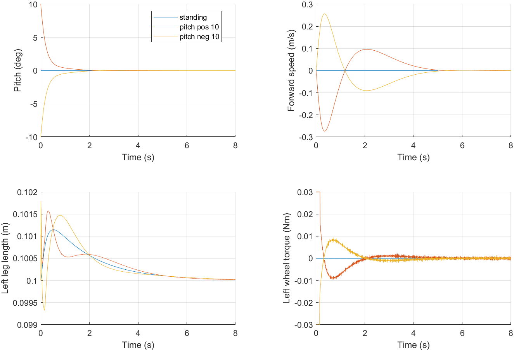
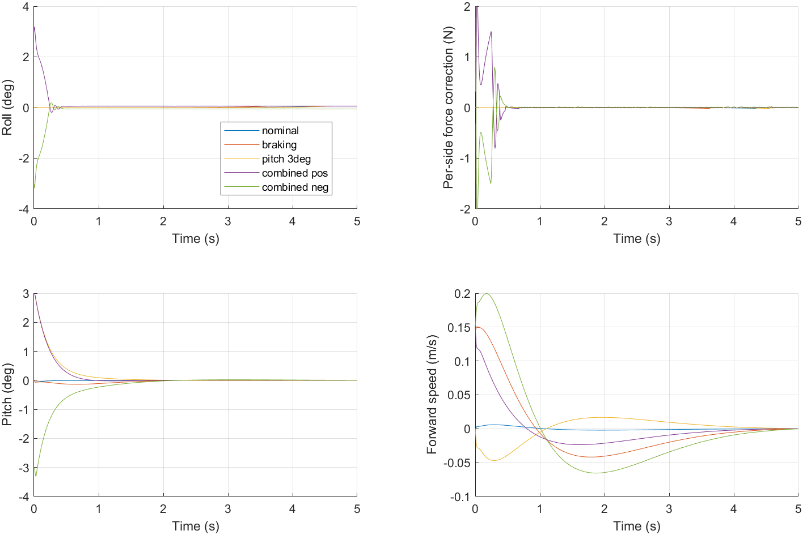

# 轮腿平衡机器人仿真：LQR 与 LMPC

基于 MATLAB / Simulink / Simscape Multibody 的三维轮腿机器人仿真。仓库包含两套控制方案：

- **LQR**：六状态离散 LQR，随虚拟腿长调度反馈增益，配合腿长支撑控制和 VMC。
- **LMPC + Roll PD**：前后平衡采用线性模型预测控制，加入力矩与每拍力矩变化约束；横滚通过左右差动支撑力的 PD 控制回正。

机械模型与初始 LQR 推导由作者自行搭建。本仓库提供仿真工程、集中参数入口和可复现的验证脚本。

**两套模型目前保留各自的物理参数，不能直接把曲线差异解释为算法优劣。** 主要差异见下表及 [参数说明](docs/parameters.md)。

## 环境

本次发布在 **MATLAB R2023b / Windows** 上验证。其他 MATLAB 版本尚未验证。

两套模型都需要 MATLAB、Simulink、Simscape、Simscape Multibody 和 Control System Toolbox。LMPC 还需要 Model Predictive Control Toolbox。仓库不包含这些商业软件或其库文件。

模型内包含 MATLAB Function 模块，运行环境还应配置该版本支持的 C/C++ 编译器；R2023b 的支持范围见 [MathWorks 编译器列表](https://www.mathworks.com/content/dam/mathworks/mathworks-dot-com/support/sysreq/files/system-requirements-release-2023b-supported-compilers.pdf)。

## 快速运行

下载仓库，将 MATLAB 当前目录切换到仓库根目录。打开 LQR：

```matlab
check_environment('lqr');
open_simulation('lqr');
```

打开 LMPC 与横滚控制：

```matlab
check_environment('lmpc_roll');
open_simulation('lmpc_roll');
```

模型打开后点击 **Run**。入口会切换到所选控制器目录，初始化参数、设置独立缓存目录并打开 Mechanics Explorer。切换目录也避免旧工程的同名初始化函数被优先调用。两套模型可以分别使用，不需要 STM32 工程、ESP 工程或作者电脑上的其他目录。

不要执行 `addpath(genpath(...))`；选择入口会只加入对应控制器及其测试目录，避免其他工程的同名函数干扰。

## 目录

```text
wheel-legged-simulation/
├── README.md
├── LICENSE
├── check_environment.m
├── open_simulation.m
├── run_validation.m
├── lqr/
│   ├── Self_Model_3D.slx
│   ├── init_lqr_model.m
│   ├── lqr_model_parameters.m
│   ├── open_lqr.m
│   └── tests/test_lqr.m
├── lmpc_roll/
│   ├── Self_Model_3D_LMPC_Roll.slx
│   ├── init_roll_lmpc.m
│   ├── lmpc_parameters.m
│   ├── roll_parameters.m
│   ├── open_roll_lmpc.m
│   └── tests/
└── docs/
```

缓存与测试结果写入各控制器的 `.cache/`、`results/`，不纳入版本管理。旧工程、备份、未保存的 autosave 和硬件运行记录不包含在发布包中。

## 参数入口

| 项目 | LQR | LMPC + Roll PD |
|---|---|---|
| 参数文件 | `lqr/lqr_model_parameters.m` | `lmpc_roll/lmpc_parameters.m`、`roll_parameters.m` |
| 机身质量 | 1.100 kg | 1.450 kg |
| 整机质量 | 1.450 kg | 约 1.726 kg |
| 轮半径 | 26 mm | 20 mm |
| 机身宽度 | 150 mm | 100 mm |
| 虚拟腿长 | 100 mm | 100 mm |
| 控制周期 | 5 ms | 5 ms |
| 每轮力矩上限 | 0.03 N·m | 0.03 N·m |
| 每关节力矩上限 | 0.68 N·m | 0.68 N·m |
| 横滚专用控制 | 无 | 左右支撑力 PD，修正 ±2 N / 侧 |

修改参数后重新运行仿真。腿连杆的几何尺寸还出现在模型中的 VMC 函数和实体几何里，不能只改质量参数文件就认为连杆尺寸已全部同步。详见 [参数与符号](docs/parameters.md)。

## 验证与曲线

关闭两套主模型后，在仓库根目录运行：

```matlab
reports = run_validation('all');
```

也可以分别执行 `run_validation('lqr')` 或 `run_validation('lmpc_roll')`。验证结果与曲线保存在对应 `results/`，最新发布验证摘要见 [验证记录](docs/validation.md)。

LQR 检查站立与初始俯仰 ±10° 恢复。LMPC 检查站立、初始速度 0.15 m/s 制动、初始俯仰 3° 和左右组合扰动。测试同时检查腿长恢复、轮与关节实际输出限幅；LMPC 还检查 QP 状态与横滚恢复。

各自模型的验证曲线：





这里的制动测试是**给定初始速度后回到零参考**，不是遥控速度阶跃跟踪。当前发布不包含实机遥控、固件的停车补偿、参数学习或电压驱动模型，也没有验证 yaw 跟踪。

## 已知限制

- 两套模型的物理参数不同，尚未建立同一被控对象上的公平算法对比。
- 仿真中的轮/关节执行器接收力矩，不能直接等同于实机无电流环驱动的电压命令。
- 线性化基于固定腿长和直立附近状态；LQR 增益调度的极点检查不能代替完整非线性鲁棒性验证。
- 部分初始化工况可能出现关节位置目标未完全满足、零延时块直接馈通警告。详细情况见验证记录。
- LQR 的 350 g 轮腿质量分配使用几何比例估计，等效密度不代表实际材料。

## 许可证与来源

作者选择 [MIT License](LICENSE)。模型、初始化和参数文件的来源及本次整理范围见 [来源说明](docs/provenance.md)。MATLAB 与 MathWorks 工具箱按各自许可证使用。
